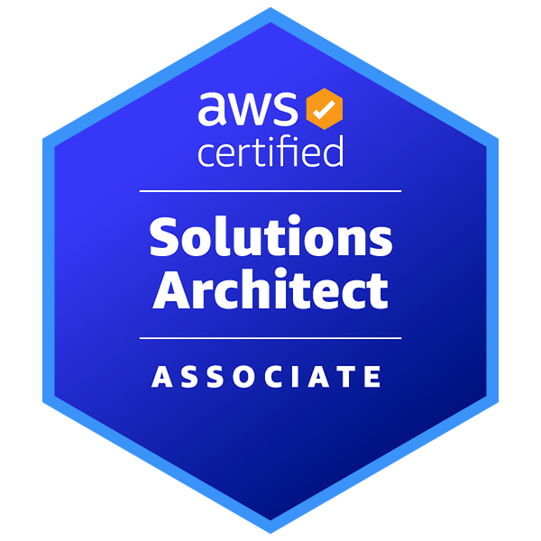

<!-- ══════════════════════════════════════════════════════════════════════════
     Muhammad Usman Shams — Official GitHub Profile README
     Software Engineer · AI/ML Researcher · UI/UX Systems Architect
     ══════════════════════════════════════════════════════════════════════════ -->

  <!-- ── HEADER BANNER ── -->
  

  <!-- ── SUBTITLE METRICS ── -->
  

    <b>⚡ 22+ AI/ML Projects (14 Public · 9 Private) &nbsp;&nbsp;·&nbsp;&nbsp; 📄 7 Published Papers · 5 Under Review &nbsp;&nbsp;·&nbsp;&nbsp; 🏆 AWS · Azure · Google Certified &nbsp;&nbsp;·&nbsp;&nbsp; 🎓 CGPA 3.68/4.00 (Rank 4th)</b>
  

  <!-- ── DYNAMIC TYPING SVG ── -->
  

  <!-- ── SOCIAL LINKS & VIEWS ── -->
  

    &nbsp;
    &nbsp;
    &nbsp;
    &nbsp;
    &nbsp;
    &nbsp;
    &nbsp;
    
  

---

<!-- ══════════════════════════ ABOUT ME ══════════════════════════ -->

###  &nbsp;About Me

I am a **Software Engineer** & **AI Researcher** architecting next-generation intelligent systems — engineering **Autonomous Digital Twins**, **Multilingual Agentic RAG**, and **Resilient Cloud Systems** for enterprise environments.

<table>
<tr><td>

**🏛️ &nbsp;Research**
- AI Researcher at **Beijing Institute of Technology** & **Wuhan University of Technology**
- Supervised by *Dr. Muhammad Usman Shoukat* — authoring Q1 journals & IEEE conference papers
- **7 peer-reviewed and accepted publications** with **5 additional Q1 manuscripts** currently under peer review
- **22+ completed ML/AI research systems** (14 Public · 9 Private repositories) across healthcare, robotics, autonomous systems & NLP
- **Invited Presenter** at **ICON '26 Qatar**, **Robotic Super Intelligence Conference China 2026 (ICSR 2026)**, and **IEEE EIC 2025**

**🎓 &nbsp;Academics**
- BS Software Engineering — **KFUEIT** *(CGPA 3.68/4.00 · Class Rank 4th / Entire Batch 2022–2026 · Dean's Honor)*

**🏆 &nbsp;Certifications**
- **AWS Certified Solutions Architect – Associate** (Amazon Web Services)
- **Microsoft Certified: AI Agents Developer – Associate** (Microsoft Azure)
- **Google UX Design Professional Certificate** (Google)

**🔬 &nbsp;Core Research Vectors**
- Network Security Digital Twins (NetTwin · Conformal Prediction) · Agentic AI & Multilingual RAG · Battery Digital Twins (PINN-STGAT) · Kolmogorov-Arnold Networks (KAN) · FBG Optical Sensing · Semi-Supervised Learning · Hierarchical Edge Robotics Perception

</td></tr>
</table>

---

<!-- ══════════════════════════ TECH STACK ══════════════════════════ -->

###  &nbsp;Technology Stack

<!-- Skill Icons (Official Logos) -->

    

<table>
  <tr>
    <td align="center" width="150"><b>🧠 AI & Deep Learning</b></td>
    <td>
      
      
      
      
      
      
      
      
      
      
    </td>
  </tr>
  <tr>
    <td align="center"><b>☁️ Cloud & Backend</b></td>
    <td>
      
      
      
      
      
      
      
      
      
    </td>
  </tr>
  <tr>
    <td align="center"><b>🌐 Frontend & Web</b></td>
    <td>
      
      
      
      
      
      
      
    </td>
  </tr>
  <tr>
    <td align="center"><b>🎨 Design & UX</b></td>
    <td>
      
      
      
      
      
      
    </td>
  </tr>
</table>

---

<!-- ═══════════════════ FLAGSHIP PROJECTS ═══════════════════ -->

###  &nbsp;Flagship Research & AI/ML Projects (22+ Systems · 14 Public · 9 Private)

<table>
  <tr>
    <td colspan="2" width="100%" valign="top">
      <h4 align="center">🛡️&nbsp; <a href="https://github.com/usshamsuddeen/NetTwin">NetTwin — Network Security Digital Twin</a> &nbsp;<code>Public</code></h4>
      
<b>28 Years Elapsed [29 Years Inclusive] of Intrusion Detection (1998–2026) · Conformal Guarantees</b>

      
Zero-Disk Network Security Digital Twin evaluated across <b>30 intrusion benchmarks (430,951 flows)</b> from DARPA 1998 to ASEADOS-SDN-IoT 2026. Delivers <b>97.49% Mean Detection Rate</b> with marginal finite-sample conformal coverage guarantees ($1-\alpha \ge 90\%$) and zero local disk footprint via in-memory AWS streaming.

      

        
        
        
        
        
      

    </td>
  </tr>
  <tr>
    <td width="50%" valign="top">
      <h4 align="center">🤖&nbsp; <a href="https://github.com/usshamsuddeen/behavioral-agentic-ai">Behavioral Agentic AI</a> &nbsp;<code>Public</code></h4>
      
<b>Multilingual Sentiment Intelligence · RAG · Churn Prediction</b>

      
Production-grade system supporting <b>12+ languages</b> with automated sentiment escalation, knowledge-retrieval (RAG), live analytics dashboard, and customer churn prediction. Deployed on VPS.

      

        
        
        
        
      

    </td>
    <td width="50%" valign="top">
      <h4 align="center">📈&nbsp; <a href="https://github.com/usshamsuddeen/MS-DED-Multi-Signal-Dynamic-Escalation-Detection">MS-DED Escalation AI</a> &nbsp;<code>Public</code></h4>
      
<b>EJASET 2026 / HAL · Emotional Velocity · F1: 0.941</b>

      
Multi-Signal Dynamic Escalation Detection using emotional velocity vectors, acoustic pitch-rate, and false-positive suppression for customer support conversational AI agents.

      

        
        
        
      

    </td>
  </tr>
  <tr>
    <td width="50%" valign="top">
      <h4 align="center">🔋&nbsp; <a href="https://github.com/usshamsuddeen/Battery-Digital-Twin-with-PINN-STGAT">Battery Digital Twin — PINN-STGAT</a> &nbsp;<code>Public</code></h4>
      
<b>IEEE IECON 2026 · Physics-Informed Graph Attention</b>

      
Industry-grade Battery Digital Twin using physics-informed spatial-temporal graph attention networks for voltage-decoupled SoC estimation from multiplexed FBG optical sensor data.

      

        
        
        
        
      

    </td>
    <td width="50%" valign="top">
      <h4 align="center">📡&nbsp; <a href="https://github.com/usshamsuddeen/Deep-Sensing-AI-FBG-Battery-Monitoring">Deep Sensing AI — FBG Monitoring</a> &nbsp;<code>Public</code></h4>
      
<b>Fiber-Optic Intelligence · 731K+ Data Points · 93% Accuracy</b>

      
Real-time battery health monitoring using Hybrid LSTM+GRU with Attention mechanism. Trained on <b>731,000+</b> data points with SHAP-based explainable AI visualization for thermal runaway detection.

      

        
        
        
      

    </td>
  </tr>
  <tr>
    <td width="50%" valign="top">
      <h4 align="center">🚗&nbsp; <a href="https://github.com/usshamsuddeen/Autonomous-Systems-Digital-Twin-Multitask-KAN">Autonomous Systems — Multitask KAN</a> &nbsp;<code>Public</code></h4>
      
<b>Kolmogorov-Arnold Networks · BiLSTM · Sensor Fusion</b>

      
Novel AI architecture using Kolmogorov-Arnold Networks + BiLSTM for real-time autonomous vehicle fault detection. Processes camera, radar, and LiDAR data in virtual digital twin environments.

      

        
        
        
      

    </td>
    <td width="50%" valign="top">
      <h4 align="center">🔬&nbsp; <a href="https://github.com/usshamsuddeen/Advanced-CV-Research-Cancer-Multi-Model-Classification">Medical CV — HybridNet Benchmark</a> &nbsp;<code>Public</code></h4>
      
<b>9 Architectures Compared · 94.57% Accuracy · 0.9502 ROC AUC</b>

      
Systematic benchmark of 9 deep learning architectures for tumor classification. Custom <b>HybridNet</b> achieved <b>94.57% accuracy</b> and <b>0.9502 ROC AUC</b>, outperforming larger SOTA architectures.

      

        
        
        
      

    </td>
  </tr>
  <tr>
    <td width="50%" valign="top">
      <h4 align="center">🤖&nbsp; <a href="https://github.com/usshamsuddeen/AI-ML-Hierarchical-Perception-for-Home-Use-Robots">Hierarchical Robotics Perception</a> &nbsp;<code>Public</code></h4>
      
<b>IEEE ICSR 2026 · YOLOv8 · 6-DoF Pose Estimation</b>

      
Hierarchical YOLOv8 perception pipeline for household service robots — real-time object detection, fine-grained classification, 6-DoF pose estimation, and grasp reasoning on edge devices.

      

        
        
        
      

    </td>
    <td width="50%" valign="top">
      <h4 align="center">🧪&nbsp; <a href="https://github.com/usshamsuddeen/ML-Solution-Architecture-1-SSL-Noisy-PseudoLabel-Refinement">SSL — HybridBalance Framework</a> &nbsp;<code>Public</code></h4>
      
<b>Graph Consensus · Contrastive Consistency · +45% Minority Acc</b>

      
Research framework (HybridBalance) for training AI on limited labeled data. Solves incorrect label pollution and skewed distributions, improving minority class accuracy by <b>+45%</b>.

      

        
        
        
      

    </td>
  </tr>
  <tr>
    <td width="50%" valign="top">
      <h4 align="center">📊&nbsp; <a href="https://github.com/usshamsuddeen/ML-Solution-Architecture-2-SSL-Class-Imbalance-BalanceMatch">SSL — BalanceMatch Architecture</a> &nbsp;<code>Public</code></h4>
      
<b>Prototypical Networks · Representation Learning · SOTA</b>

      
Novel semi-supervised architecture integrating BalanceMatch with Prototypical Networks to dramatically bolster minority class representation in severely imbalanced data distributions.

      

        
        
        
      

    </td>
    <td width="50%" valign="top">
      <h4 align="center">💳&nbsp; <a href="https://github.com/usshamsuddeen/DACC-Deterministic-Atomic-Conversational-Checkout">DACC — Deterministic Conversational Checkout</a> &nbsp;<code>Public</code></h4>
      
<b>Deterministic Finite State · Zero Hallucination Commerce</b>

      
Deterministic conversational checkout architecture preventing transactional hallucination in autonomous conversational e-commerce agents via finite-state verification.

      

        
        
        
      

    </td>
  </tr>
</table>

  
<b>📌 &nbsp;All Repositories — 14 Public & 9 Private Specialized Systems</b>

   
  <table>
    <tr><th width="40%">Repository</th><th width="45%">Description & Core Research Vector</th><th width="15%">Access</th></tr>
    <tr>
      <td><b>🛡️ <a href="https://github.com/usshamsuddeen/NetTwin">NetTwin</a></b></td>
      <td>Zero-Disk Network Security Digital Twin across 30 intrusion benchmarks (1998–2026)</td>
      <td><code>Public</code></td>
    </tr>
    <tr>
      <td><b>🤖 <a href="https://github.com/usshamsuddeen/behavioral-agentic-ai">behavioral-agentic-ai</a></b></td>
      <td>Multilingual sentiment intelligence, RAG escalation, and live churn analytics</td>
      <td><code>Public</code></td>
    </tr>
    <tr>
      <td><b>📈 <a href="https://github.com/usshamsuddeen/MS-DED-Multi-Signal-Dynamic-Escalation-Detection">MS-DED</a></b></td>
      <td>Multi-Signal Dynamic Escalation Detection using emotional velocity (EJASET 2026 / HAL)</td>
      <td><code>Public</code></td>
    </tr>
    <tr>
      <td><b>🔋 <a href="https://github.com/usshamsuddeen/Battery-Digital-Twin-with-PINN-STGAT">Battery-Digital-Twin-PINN-STGAT</a></b></td>
      <td>Physics-informed graph attention network for multiplexed FBG optical battery twin (IEEE IECON)</td>
      <td><code>Public</code></td>
    </tr>
    <tr>
      <td><b>📡 <a href="https://github.com/usshamsuddeen/Deep-Sensing-AI-FBG-Battery-Monitoring">Deep-Sensing-AI-FBG-Monitoring</a></b></td>
      <td>Real-time battery health & thermal runaway detection on 731K data points with SHAP XAI</td>
      <td><code>Public</code></td>
    </tr>
    <tr>
      <td><b>🚗 <a href="https://github.com/usshamsuddeen/Autonomous-Systems-Digital-Twin-Multitask-KAN">Autonomous-Systems-Multitask-KAN</a></b></td>
      <td>Kolmogorov-Arnold Networks + BiLSTM for real-time AV fault detection & sensor fusion</td>
      <td><code>Public</code></td>
    </tr>
    <tr>
      <td><b>💳 <a href="https://github.com/usshamsuddeen/DACC-Deterministic-Atomic-Conversational-Checkout">DACC-Checkout</a></b></td>
      <td>Deterministic conversational checkout agent preventing hallucination in e-commerce transactions</td>
      <td><code>Public</code></td>
    </tr>
    <tr>
      <td><b>🔒 <a href="https://github.com/usshamsuddeen/ZL-AgentFabric-Zero-Leakage-Multi-Tenant-Architecture">ZL-AgentFabric</a></b></td>
      <td>Zero-Leakage multi-tenant conversational agent architecture with cryptographic isolation</td>
      <td><code>Public</code></td>
    </tr>
    <tr>
      <td><b>🔬 <a href="https://github.com/usshamsuddeen/Advanced-CV-Research-Cancer-Multi-Model-Classification">Advanced-CV-Cancer-Classification</a></b></td>
      <td>HybridNet 9-architecture systematic deep learning benchmark (94.57% accuracy, 0.9502 ROC AUC)</td>
      <td><code>Public</code></td>
    </tr>
    <tr>
      <td><b>🧪 <a href="https://github.com/usshamsuddeen/ML-Solution-Architecture-1-SSL-Noisy-PseudoLabel-Refinement">SSL-Solution-Architecture-1</a></b></td>
      <td>HybridBalance framework solving noisy pseudo-labels with graph consensus (+45% minority acc)</td>
      <td><code>Public</code></td>
    </tr>
    <tr>
      <td><b>📊 <a href="https://github.com/usshamsuddeen/ML-Solution-Architecture-2-SSL-Class-Imbalance-BalanceMatch">SSL-Solution-Architecture-2</a></b></td>
      <td>BalanceMatch + Prototypical Networks for severe class imbalance in semi-supervised learning</td>
      <td><code>Public</code></td>
    </tr>
    <tr>
      <td><b>🤖 <a href="https://github.com/usshamsuddeen/AI-ML-Hierarchical-Perception-for-Home-Use-Robots">Hierarchical-Perception-Robots</a></b></td>
      <td>Hierarchical YOLOv8 edge perception & 6-DoF pose estimation (IEEE ICSR 2026)</td>
      <td><code>Public</code></td>
    </tr>
    <tr>
      <td><b>💊 <a href="https://github.com/usshamsuddeen/Smart-Pharma-Inventory-AI">Smart-Pharma-Inventory-AI</a></b></td>
      <td>Pharmaceutical supply chain predictive intelligence dashboard with real-time analytics</td>
      <td><code>Public</code></td>
    </tr>
    <tr>
      <td><b>🏢 <a href="https://github.com/usshamsuddeen/tech-enterprise-redesign">tech-enterprise-redesign</a></b></td>
      <td>Complete architectural redesign and UI/UX modernization of enterprise tech platform</td>
      <td><code>Public</code></td>
    </tr>
    <tr>
      <td><b>🚇 TDAG-Net</b></td>
      <td>Adaptive Graph Learning with Persona-Aware Interpretability for Metro Passenger Flow Prediction</td>
      <td><code>Private</code></td>
    </tr>
    <tr>
      <td><b>🚇 CRISP-Net</b></td>
      <td>Forecasting Metro Entry and Exit Flows with Direction-Specific Prediction Intervals</td>
      <td><code>Private</code></td>
    </tr>
    <tr>
      <td><b>🤖 Hierarchical YOLOv8 (IEEE TCE)</b></td>
      <td>Object Detection, Pose Estimation, and Grasp Reasoning for Home-Use Robots (Journal Paper)</td>
      <td><code>Private</code></td>
    </tr>
    <tr>
      <td><b>☁️ AWS Cloud Infrastructure Core</b></td>
      <td>Comprehensive Cloud Architecture Assets, IaC, Tools and Solutions Architect Materials</td>
      <td><code>Private</code></td>
    </tr>
    <tr>
      <td><b>🧠 SentimentRAG Production Pipeline</b></td>
      <td>Emotion-Aware Knowledge Retrieval Engine with Temporal User State Trajectories</td>
      <td><code>Private</code></td>
    </tr>
    <tr>
      <td><b>🛍️ Affective E-Commerce Closed-Loop</b></td>
      <td>Closed-loop feedback framework for adaptive, emotion-calibrated support agents</td>
      <td><code>Private</code></td>
    </tr>
    <tr>
      <td><b>📦 Atomic Inventory Serialization Engine</b></td>
      <td>High-throughput deterministic concurrency controller for autonomous conversational transactions</td>
      <td><code>Private</code></td>
    </tr>
    <tr>
      <td><b>🔐 Agentic Multi-Tenant Crypto-Sandbox</b></td>
      <td>Hardware-enclave isolation and cryptographic verification for multi-tenant LLM agents</td>
      <td><code>Private</code></td>
    </tr>
    <tr>
      <td><b>🔋 PhysioTwin Degradation Forecaster</b></td>
      <td>Real-Time Lithium-Ion Degradation Forecasting with Physics-Guided Neural Operators</td>
      <td><code>Private</code></td>
    </tr>
  </table>

---

<!-- ═══════════════════ PUBLICATIONS ═══════════════════ -->

###  &nbsp;Peer-Reviewed Publications & Conferences (7 Published · 5 Under Review)

| # | Title | Venue | Year | Link |
|:---:|:---|:---|:---:|:---:|
| **P7** | Multi-Signal Dynamic Escalation Detection Using Emotional Velocity and False-Positive Suppression in Customer Service AI | *European J. of Applied Science, Eng. & Tech. (EJASET)* | 2026 | [HAL](https://hal.science/hal-05865409v1) / [DOI](https://doi.org/10.59324/ejaset.2026.4(6).12) |
| **P6** | Battery Digital Twin with Spatial-Temporal Graph Attention Networks for State of Charge Estimation | *IEEE IECON 2026* | 2026 | [Link](https://www.iecon2026.org/) |
| **P5** | YOLOv8-Based Object Detection and Localization for Home-Use Robot | *Intl Conf on Superintelligence & Robotics (ICSR 2026)* | 2026 | [Link](https://www.icsr-conf.com/) |
| **P4** | Comparative Analysis on AI-Driven Human Digital Twin for Personalized Medicine | *J. of Clinical Practice & Medical Research* | 2025 | [DOI](https://doi.org/10.59324/jcpmr.2025.1(1).06) |
| **P3** | Framework for Mitigating Adversarial Attacks on CNN Models | *Scientific J. of Engineering Research* | 2025 | [DOI](https://doi.org/10.64539/sjer.v1i4.2025.349) |
| **P2** | Design and Implementation of a Smart Footsteps Power Generation System | *European J. of Applied Science, Eng. & Tech.* | 2025 | [DOI](https://doi.org/10.59324/ejaset.2025.3(5).14) |
| **P1** | Rolling Bearing Fault Detection using Deep Learning: Industry 4.0/5.0 | *Scientia: Technology, Science & Society* | 2024 | [DOI](https://doi.org/10.59324/stss.2024.1(3).06) |

  
<b>📄 &nbsp;5 Additional Q1 Journal Manuscripts (Currently Under Peer Review)</b>

   
  <table>
    <tr><th>#</th><th>Title</th><th>Target Journal (Publisher)</th><th>Status</th></tr>
    <tr><td><b>P8</b></td><td>SentimentRAG: Emotion-Aware Knowledge Retrieval with Temporal User State Modeling</td><td><i>Information Sciences</i> (Elsevier, INS-D-26-11575)</td><td><code>Under Review — Q1</code></td></tr>
    <tr><td><b>P9</b></td><td>Bridging Affective Computing and Intelligent Information Systems: A Closed-Loop Framework</td><td><i>Engineering Applications of AI</i> (Elsevier)</td><td><code>Under Review — Q1</code></td></tr>
    <tr><td><b>P10</b></td><td>Deterministic Conversational Commerce via Finite-State Checkout Agents and Atomic Inventory</td><td><i>Expert Systems with Applications</i> (Elsevier)</td><td><code>Under Review — Q1</code></td></tr>
    <tr><td><b>P11</b></td><td>Zero-Leakage Multi-Tenant Agent Architecture with Cryptographic Isolation</td><td><i>IEEE Transactions on Information Forensics and Security</i></td><td><code>Under Review — Q1</code></td></tr>
    <tr><td><b>P12</b></td><td>PhysioTwin-FBG: Real-Time Lithium-Ion Degradation Forecasting with Physics-Guided Operators</td><td><i>IEEE Transactions on Industrial Informatics</i></td><td><code>Under Review — Q1</code></td></tr>
  </table>

---

<!-- ═══════════════════ CERTIFICATIONS ═══════════════════ -->

### 🏅 &nbsp;International Certifications & Honors

  <!-- ── Official Certification Badges ── -->
  <table>
    <tr>
      <td align="center" width="33%">
          
        <b>Solutions Architect</b> 
        Associate · Amazon Web Services 
        Certified — Aug 2026
      </td>
      <td align="center" width="33%">
          
        <b>AI Agents Developer</b> 
        Associate · Microsoft Azure 
        Certified — July 2026
      </td>
      <td align="center" width="33%">
          
        <b>UX Design Professional</b> 
        Certificate · Google 
        Certified — Feb 2023
      </td>
    </tr>
  </table>

  <!-- ── Academic Honors ── -->
   
  &nbsp;&nbsp;
  &nbsp;&nbsp;
  

---

<!-- ═══════════════════ RESEARCH AREAS ═══════════════════ -->

### 🔬 &nbsp;Research Interests

  <table>
    <tr>
      <td align="center">
        <b>🤖 Intelligent Systems</b>  
        &nbsp;
        &nbsp;
        &nbsp;
        
      </td>
      <td align="center">
        <b>🧬 Deep Learning & Architecture</b>  
        &nbsp;
        &nbsp;
        &nbsp;
        
      </td>
    </tr>
    <tr>
      <td align="center">
        <b>🏥 Domain Applications</b>  
        &nbsp;
        &nbsp;
        
      </td>
      <td align="center">
        <b>⚙️ Systems & Robotics</b>  
        &nbsp;
        &nbsp;
        
      </td>
    </tr>
  </table>

---

<!-- ═══════════════════ GITHUB STATISTICS ═══════════════════ -->

###  &nbsp;GitHub Analytics & Live Activity

  <!-- ── Dynamic Live Streak & Contribution Stats ── -->
    

  <!-- ── Dynamic Live Stats Cards (Auto-updating in real-time via GitHub API) ── -->
  

    &nbsp;
    &nbsp;
    &nbsp;
    
  

---

<!-- ═══════════════════ CONNECT ═══════════════════ -->

  ###  &nbsp;Let's Connect & Collaborate

  

    I am actively open to <b>research collaborations</b>, <b>AI/ML engineering opportunities</b>, 
    and <b>cutting-edge software architecture discussions</b>.
  

  

    &nbsp;
    &nbsp;
    &nbsp;
    
  

  <!-- ── FOOTER BANNER ── -->
  

